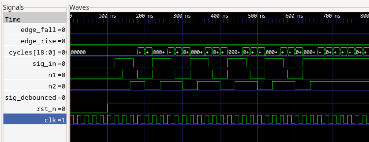
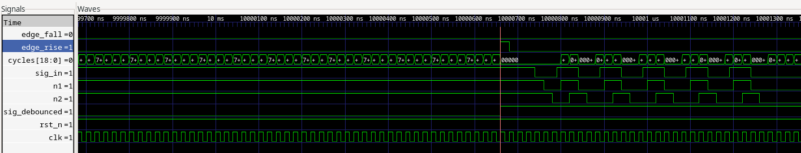
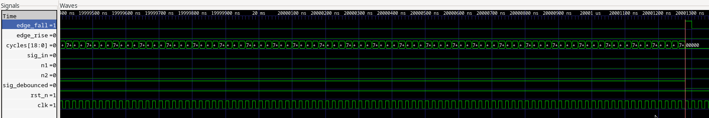
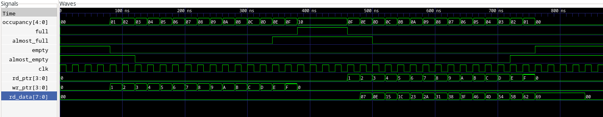
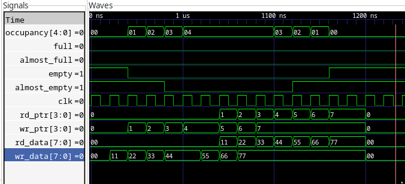
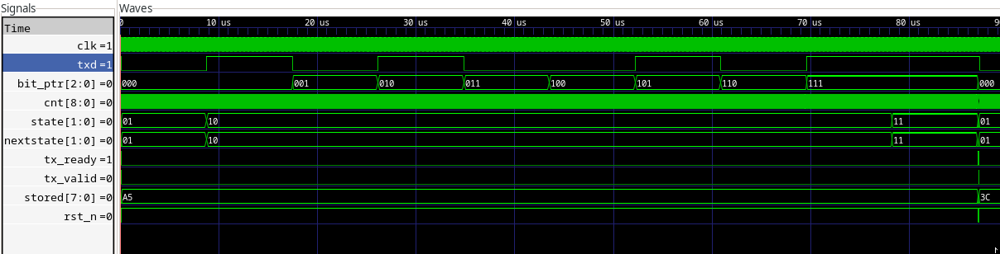
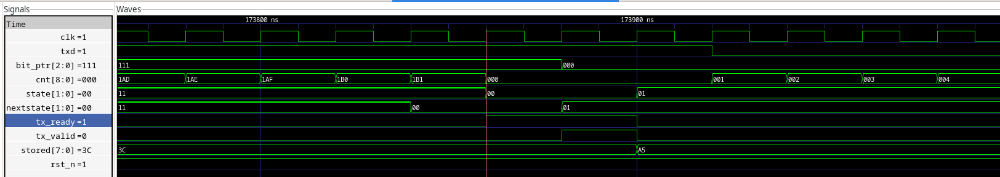
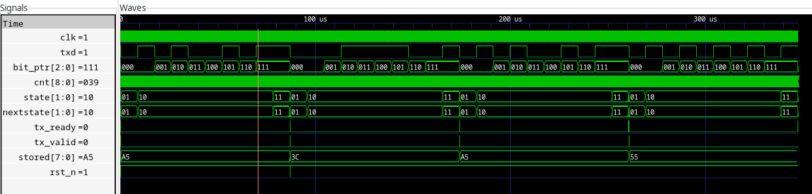

## Onboarding Tasks Submission – AGH Logic Unit

**Contributor:** @HeniexMush

---

### 1. Implementation Summary & Design Decisions
* **Task 1 (Debouncer):** *(Briefly explain how you calculated counter bounds and generated the 1-cycle edge pulses)*
   I used $clog2 to find bit lenght. The edge pulses are generated only when the counter reaches the required cycles, every clock they are also set to 0 to ensure 1 clock pulse
* **Task 2 (Sync FIFO):** *(How did you handle pointer progression and occupancy update during simultaneous read & write?)*
   The occupancy does not change during simultaneous read & write only the pointers go up by 1
* **Task 3 (UART TX):** *(Briefly describe your FSM state transitions and baud rate prescaler mechanism)*
   I count the required cycles from the baud rate similarly to the first task
   in always_ff
   changes the state to the next state
   IDDLE: asserts ready waits for valid flag
   START: start bit, and waits for the required cycles to pass to change to DATA also it gives the first bit of the byte
   DATA: waits for the cycles to pass then gives the next bit and so on also it counts transmitted bits so it does not overflow
   STOP: stop bit and waits for the cycles to assert ready

   always_comb
   checks if the state should change, and nexstate gets the correct state (this does not change the state)
   IDDLE -> START if it valid flag is raised
   START -> DATA after the cycles pass
   DATA -> STOP after the bit pointer reaches the last bit
   STOP -> IDDLE after the cycles pass

---

### 2. Pre-Review Hardware Quality Checklist
- [ ] **Verification:** Ran `make clean_all && make all` and all 3 testbenches passed locally.
- [ ] **Simulation Waveforms:** Generated waveforms with `WAVES=1` and inspected signal transitions.
- [ ] **No Latches:** All combinational outputs have default values and complete `case`/`if` coverage.
- [ ] **Coding Rules:** Non-blocking assignments (`<=`) in sequential blocks, blocking (`=`) in combinational blocks.
- [ ] **Parameterization:** Modules scale cleanly if parameters (e.g., `DEPTH`, `CLK_FREQ_HZ`) are changed.
- [ ] **Interfaces:** All module port names, widths, and active-low resets (`rst_n`) remain untouched.
- [ ] **Git Hygiene:** Changes are committed incrementally across development (not a single bulk commit at the end) with clear commit messages (Conventional Commits encouraged).

---

### 3. Waveform Evidence (Surfer / optional GTKWave)
*Please attach screenshots illustrating key corner cases:*
1. **Debouncer:** Glitch filtering and the 1-cycle edge pulses (rising & falling).
   <!-- [Paste image here] -->
   filtering
   
   positive pulse and filtering
   
   negative pulse
   

2. **FIFO:** Full/empty flag transitions, occupancy, and read/write ordering.
   <!-- [Paste image here] -->
   write+read and changing flags
   
   write + read at the same time
   

3. **UART TX:** Start bit, data serialization (LSB first), Stop bit timing, and tx_ready handshake.
   <!-- [Paste image here] -->
   changing states and a5 (0101001011) transmission,
   start and stop bits are written on state changes and serialized bits are written on the bit_ptr change
   

   ready asserting after changing to iddle and waiting for valid to start transmission
   

   back to back transmission (after reset)
   

---

### 4. Reflection & Learning Notes
* **Most challenging bug encountered & how you solved it:**
  *(e.g., off-by-one counter cycle, Cocotb delta-cycle sampling, etc.)*
  Bug in uart that made it skip the STOP state it gave wrong results but passed much further into the test. I fixed it by checking the waveforms and reseting the clock count so it was not skipped
* **Questions or areas where you'd like feedback from reviewers:**
  *(e.g., coding style, resource utilization, alternative FSM architectures)*
  Definietely code structure, and some alternative ways to do uart, can something else be done
  instead of counting required clock cycles
